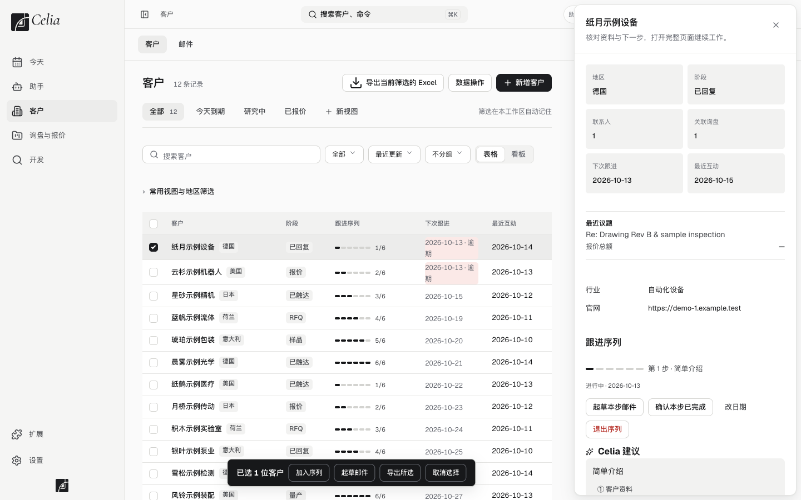
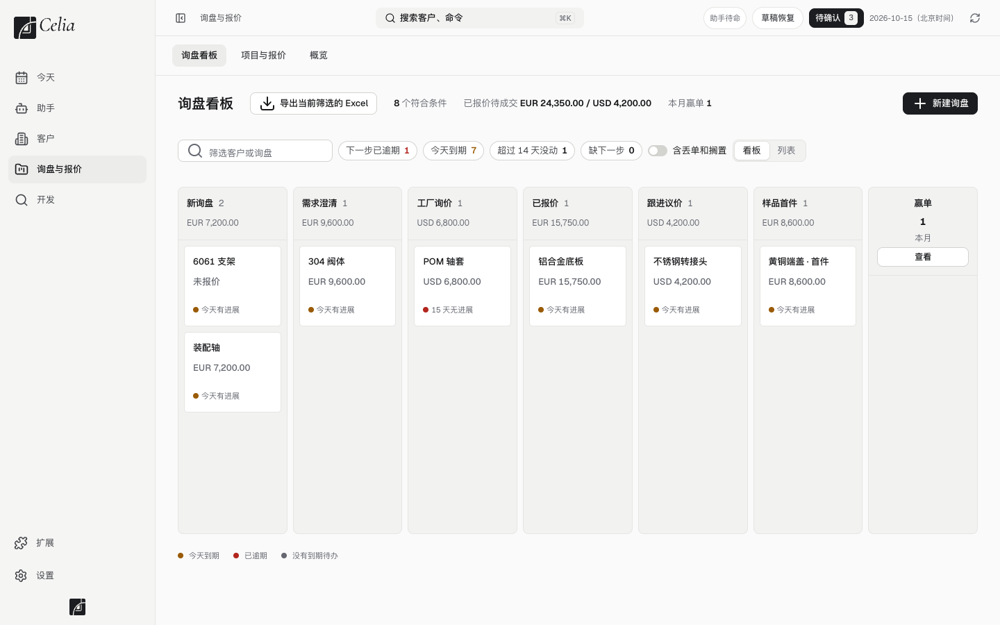
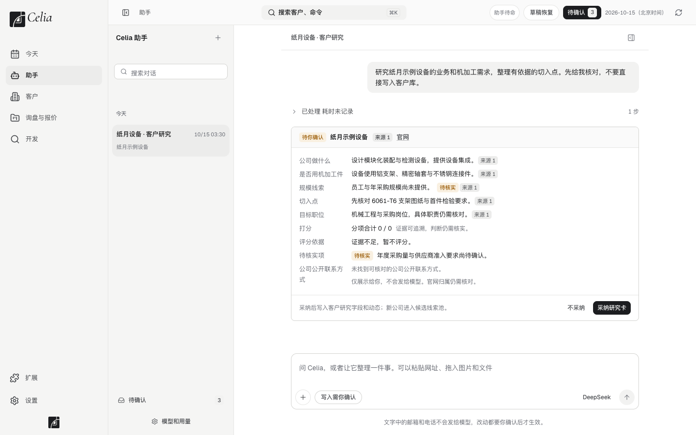
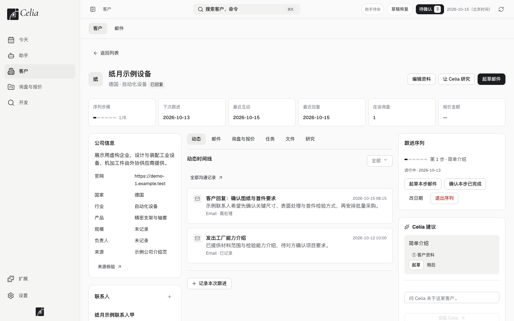
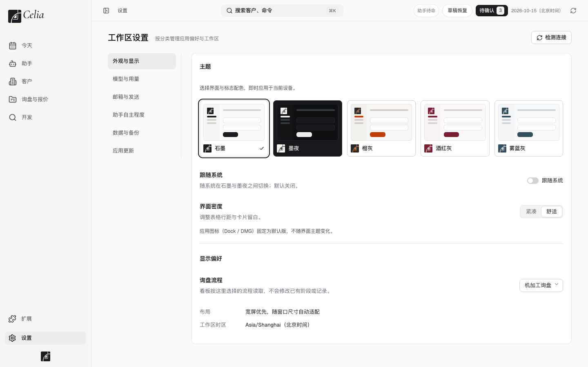
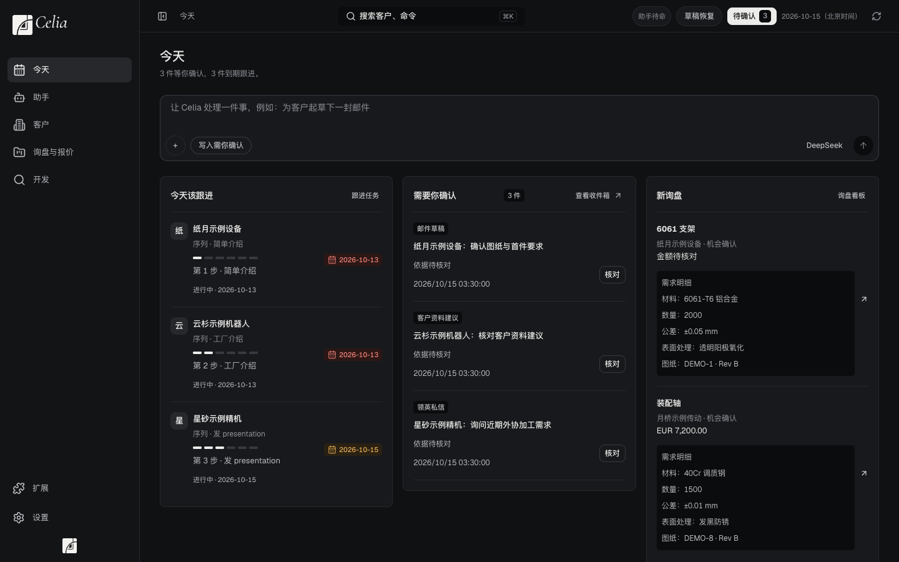
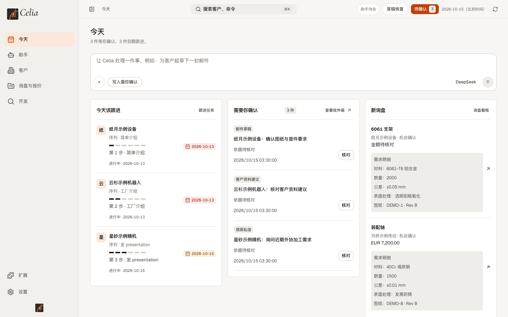

<b>外贸业务员的客户开发与跟进工作台</b> 数据留在你的 Mac 上，AI 助手帮你研究客户、起草邮件、提醒跟进——对外发出的每一封都由你确认。

<a href="../../releases/latest"><b>下载 Celia（macOS · Apple 芯片）</b></a> · <a href="INSTALL.md">安装说明</a> · <a href="PRIVACY.md">数据与隐私</a> · <a href="FAQ.md">常见问题</a>

> **首个公开版本 0.0.1 正在准备中，暂时没有可下载的安装包。** 发布后会在 [Releases](../../releases) 提供下载。

---

## 界面一览

<table>
<tr>
<td width="50%"> 客户：序列进度、下次跟进、最近互动</td>
<td width="50%"> 询盘与报价：按阶段看板，金额按币种分别合计</td>
</tr>
<tr>
<td> 邮件草稿：写明依据，由你核对后才发送</td>
<td> 助手：研究结论带来源，待核实项单独标出</td>
</tr>
<tr>
<td> 客户详情：邮件、任务、研究按时间排在一条线上</td>
<td> 设置：五套主题，标志随主题变化</td>
</tr>
</table>

 

以上截图中的公司、联系人、询盘和邮件均为虚构示例数据（网址为保留域名 example.test），不是真实客户，也不是真实的模型输出。

---

## Celia 是什么

Celia 是一个装在 Mac 上的桌面应用，为制造业外贸业务员设计，一个人就能用。它把每天最耗时间的几件事放在一处：找新客户、跟进老客户、回询盘、做报价。

- **今天**：今天该跟进谁、有哪些东西等你确认、有哪些新询盘，一屏看完。
- **客户**：客户库、联系人、往来记录和跟进任务；一家客户的邮件、回复、研究笔记和待办按时间排在同一条线上。
- **询盘与报价**：看板显示每个询盘走到哪一步、哪些停滞了；金额按币种分别合计，不跨币种相加。
- **跟进序列**：把你固定的跟进节奏（简单介绍 → 工厂介绍 → 发 presentation → 问最近有没有项目 → 发证书 → 发质检资料）做成六步序列，到期提醒，客户回复后自动暂停。步骤和间隔天数都可以修改。
- **开发**：研究过的公司、联系人线索、批量研究与导入审查。
- **助手 Celia**：研究一家公司、查找有来源的联系人、起草跟进邮件。每条结论带来源标签，依据不足时会直接说明。
- **扩展**：管理 Celia 使用的技能（如客户画像、开发信写法、工厂能力档案）和它连接的外部能力（邮箱、专用浏览器、公开网页读取）。
- **主题**：设置里可以切换五套配色（石墨、墨夜、橙灰、酒红灰、雾蓝灰），界面里的标志随之变化。

## 它怎么对待你的数据和你的客户

- **客户资料保存在你自己的电脑上**（`~/.celia`），没有账号，也没有 Celia 的服务器。
- **对外发送必须逐条确认。** 助手只能起草；邮件和领英内容由你点确认后才会发出。
- **助手改客户资料要先给你看对比**，你勾选的项才会应用。
- **更新默认关闭**，需要你查看说明并点击确认；更新包有签名和哈希校验，失败会自动回到上一版。
- 详细说明见 [数据与隐私](PRIVACY.md)。

## 需要你自己准备的

- 一台 **Apple 芯片 Mac**（M 系列）。
- 一个 **大模型服务的 API key**（助手功能需要）。设置里内置了 DeepSeek、Anthropic、OpenAI、Gemini、Kimi、智谱、百炼、MiniMax、火山方舟、OpenRouter 的配置模板，也可以自己添加兼容的服务；**目前只有 DeepSeek 做过真实调用验证**，其他品牌请先小量试用。Celia 不提供也不转售模型额度。
- 你自己的邮箱账号（用于收发邮件）。

## 安装

下载 `Celia-x.y.z-arm64.dmg`，拖进「应用程序」。由于当前版本没有苹果公证，首次打开需要在系统设置里点一次「仍要打开」，步骤见 [安装说明](INSTALL.md)。下载后建议按 [校验说明](VERIFY.md) 核对文件指纹。

## 当前状态与边界

- 版本 0.0.1（准备中），**早期版本**，仅支持 macOS（Apple 芯片）。
- 功能已用示例数据和自动化测试验证；**真实邮箱收发、除 DeepSeek 以外的模型服务、LinkedIn 功能尚未在大量真实使用中验证**，请先用不重要的数据和小量邮件试用，并定期备份 `~/.celia`。
- 未经苹果公证，因此首次打开需要手动允许。
- 领英相关功能只读、限量，使用你自己的专用浏览器资料，**由你自行承担账号风险**，详见 [FAQ](FAQ.md)。
- 本项目是个人开发的工具，按「现状」提供，见 [使用条款](TERMS.md)。

## 第三方组件

Celia 使用了大量开源组件，许可证与致谢随每个发行版附带（`NOTICE.md`、`LGPL-REPLACEMENT.md` 和对应源码包）。

English: Celia is a macOS (Apple silicon) desktop workspace for manufacturing export sales — customer development, follow-up sequences, inquiries and quotes, with an AI assistant that drafts but never sends anything without your per-item confirmation. Data stays on your Mac. Download the DMG from Releases.
