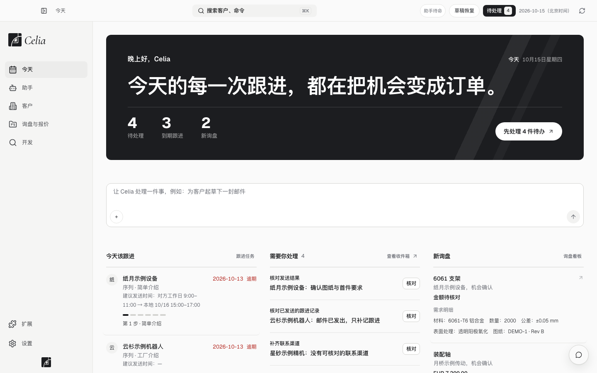
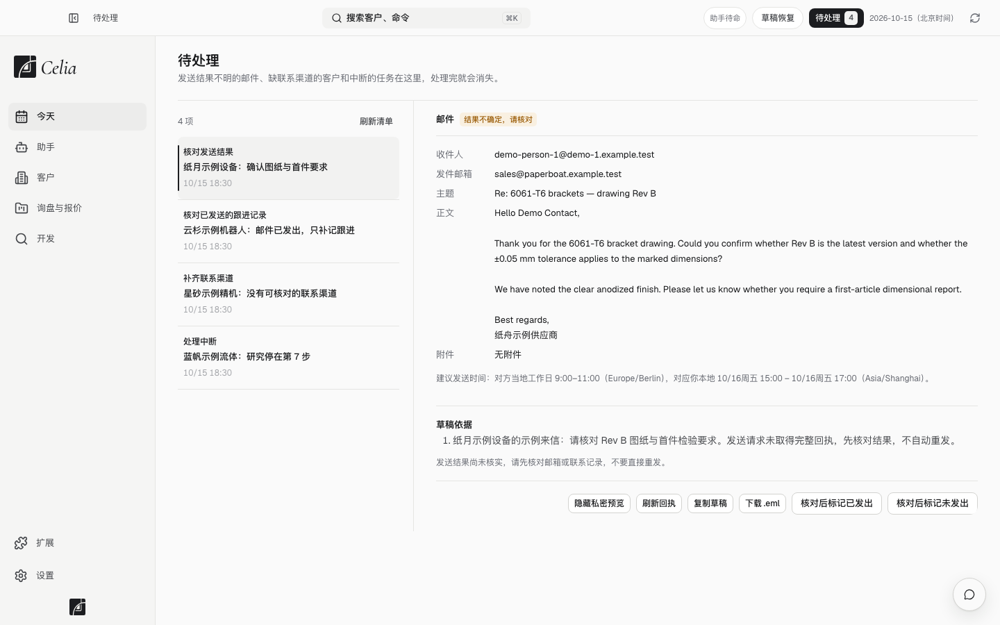

# 3. 每日工作流程

> 适用版本：0.0.8 · 更新：2026-10-30 · [返回目录](../GUIDE.md)

**目的**：每天固定按一套顺序处理，不漏跟进、不漏回复。
**什么时候用**：每天上班打开 Celia 时。大约 20–40 分钟，看客户量。

---

## 每天的顺序

```
① 看「今天」页  →  ② 清空「待处理」  →  ③ 做到期的跟进  →  ④ 处理新询盘  →  ⑤ 开发新客户  →  ⑥ 下班前收尾
```

---

## ① 看「今天」页（2 分钟）

点左边的 **今天**。

<p align="center"></p>

最上面一栏是问候和**今天的一句话**，每天换一句。旁边三个数字一眼看完今天的量：

| 数字 | 意思 |
|---|---|
| **待处理** | 需要你看一眼的事，见第 ② 步 |
| **到期跟进** | 今天到期要跟的客户 |
| **新询盘** | 新进来的询盘 |

数字下面的大按钮会告诉你**先做哪件事**：有待处理就是「先处理 N 件待办」，没有就是「去跟进 N 位客户」，都清空了就是「让 Celia 开工」，点一下就开始。

问候里的名字来自 设置 → 我的资料 里的姓名；没填时显示「Celia」。

往下是三块明细：**需要你处理**、**今天该跟进**（客户和他们在跟进序列里走到第几步）、**新询盘**（材料、数量、公差、表面处理、图纸）。

---

## ② 清空「待处理」（2–5 分钟）

点右上角的 **待处理**，或者今天页的「先处理 N 件待办」。

<p align="center"></p>

0.0.8 起，助手写好邮件和领英私信会**直接发出**，不再一封封等你点确认。所以这里只剩三类需要你看的事，处理完就会消失：

1. **发送结果不明的邮件**：比如发送时网络断了，不知道对方收到没有。先到邮箱网页版的「已发送」里看一眼，再点 **核对后标记已发出** 或 **核对后标记未发出**。Celia 不会自己重发。
   - 如果邮件其实已经发出、只是跟进记录没记上，点 **只补记跟进，不重发**。
2. **缺联系渠道的客户**：要跟进却没有邮箱或领英。到客户详情里补上，或者让助手「帮我找 某公司 采购或工程负责人的联系方式」。
3. **中断的任务**：助手做到一半停了，比如连续出错。看清原因后选 **继续：放入输入框**（把原来的要求放回输入框，由你发出）、**只保留已完成** 或 **放弃**。

> 想先看看助手发了什么：每封邮件和私信都会记在客户时间线和「客户 → 邮件」里，包括正文和发送回执。
>
> 想让助手先停下：设置 → 助手 →「暂停助手」，见[首次设置](02-setup.md#四暂停助手)。

---

## ③ 做到期的跟进（10 分钟）

在「今天该跟进」里，从上往下处理每位客户：

1. 点客户名，进入客户详情页。
2. 先看中间的 **动态时间线**：上次聊了什么、客户有没有回复。
3. 在右边的 **跟进序列** 里：
   - **客户还没回复**：点「起草本步邮件」。助手会按序列当前这一步写好并直接发出，比如「第 2 步 · 工厂介绍」。发出后点「确认本步已完成」，选这条发出记录。
   - **已经发出去了**：点「确认本步已完成」，选择对应的那条发出记录。序列只认你确认过的真实发出记录。
   - **今天不方便跟**：点「改日期」。
   - **不再跟这个客户**：点「退出序列」。进度和历史都会保留。
4. 如果是电话、微信、展会上聊的，点「**记录本次跟进**」，写一句结果和下一步。

> **客户一回复，序列就自动暂停**，避免客户已经回信了你还在发催促邮件。先处理回复，再决定恢复日期或退出。

---

## ④ 处理新询盘（看数量）

1. 在今天页的「新询盘」里点一条，或者到 **询盘与报价 → 询盘看板**。
2. 按 [询盘与报价](06-inquiries.md) 的流程推进：澄清需求 → 工厂询价 → 报价 → 跟进议价 → 样品。
3. 需求不清楚的，可以在今天页的输入框里让助手「整理这封询盘，列出已知要求和待确认项」。

---

## ⑤ 开发新客户（剩下的时间）

每天给新客户留出固定时间，按下面的顺序来：

| 步骤 | 在 Celia 里怎么做 |
|---|---|
| 1. 线索进来 | 客户 → 新增客户，或导入名单 |
| 2. 确认公司身份（官网、品牌、法律主体是不是同一家） | 让助手研究：「研究 某公司，先核对官网与已有资料」 |
| 3. 判断对方会不会用到我们的工艺 | 看研究卡里的「是否用机加工件」「切入点」 |
| 4. 合规检查（军工、制裁、敏感用途） | 研究卡有提示时停下，人工判断 |
| 5. 找对的人（采购 → 供应商开发 → 机械工程 → 小公司老板） | 开发 → 联系人发现 |
| 6. 第一次联系 | 让助手写开发信并发出，然后把客户加入跟进序列 |
| 7. 记下进展 | 每次动作后，确认客户有「下一步」和「下次跟进日期」 |

研究和写信的具体做法见[让助手工作](05-assistant.md)。

---

## ⑥ 下班前收尾（2 分钟）

- 「待处理」清零，或者只留下明天再处理的；
- 今天跟进过的客户，都有**下一步**和**下次跟进日期**；
- 没有下一步的客户，等于没跟完。

---

## 注意事项

- 助手给出的结论会标来源。标着「**待核实**」的内容，不要直接写进邮件当事实用。
- 对德国等对营销邮件要求严格的市场，第一次联系前先确认联系依据，比如对方公开的采购邮箱、展会交换的名片等。
- 敏感品类（军工、受制裁主体、用途不明）不要报价，先人工审查。

## 常见问题

**序列默认是哪几步？**
默认六步：简单介绍 → 工厂介绍 → 发 presentation → 问最近有没有项目 → 发证书 → 发质检资料，间隔 3、5、7、7、10 天。步骤名称和间隔都可以在序列设置里改，改动只影响之后新加入的客户。
