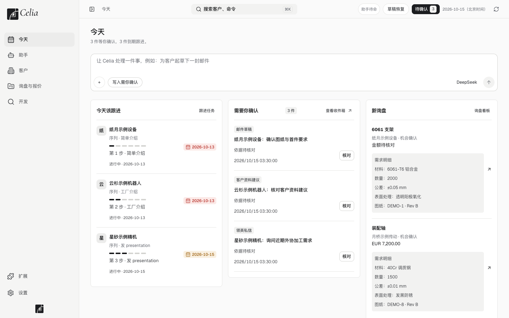
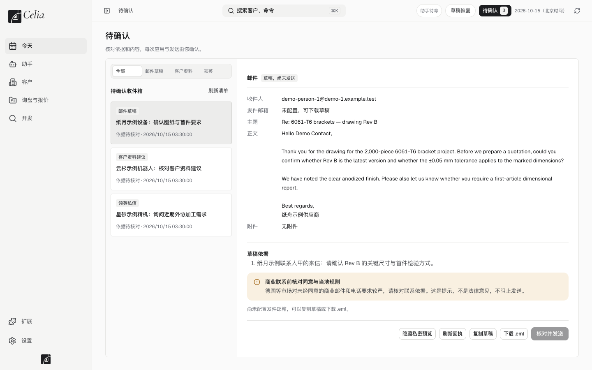

# 3. 每日工作流程

> 适用版本：0.0.6 · 更新：2026-10-18 · [返回目录](../GUIDE.md)

**目的**：每天固定按一套顺序处理，不漏跟进、不漏回复。
**什么时候用**：每天上班打开 Celia 时。大约 20–40 分钟，看客户量。

---

## 每天的顺序

```
① 看「今天」页  →  ② 处理「待确认」  →  ③ 做到期的跟进  →  ④ 处理新询盘  →  ⑤ 开发新客户  →  ⑥ 下班前收尾
```

---

## ① 看「今天」页（2 分钟）

点左边的 **今天**。页面分三块：

<p align="center"></p>

| 区域 | 看什么 |
|---|---|
| **今天该跟进** | 今天到期的客户，以及他们在跟进序列里走到第几步 |
| **需要你确认** | 助手起草好、等你核对的邮件、资料修改、领英消息 |
| **新询盘** | 新进来的询盘和它的需求明细（材料、数量、公差、表面处理、图纸） |

页面最上面有一句汇总，比如「3 件等你确认，3 件到期跟进」。

---

## ② 处理「待确认」（5–10 分钟）

点右上角的 **待确认** 按钮，或者今天页的「查看收件箱」。

<p align="center"></p>

逐条处理：

1. 点左边一条，右边会显示完整内容和**草稿依据**，也就是助手为什么这么写。
2. 核对四件事：
   - **收件人**对不对；
   - **主题和正文**有没有事实错误，尤其是价格、交期、公差这些数字；
   - **依据**是否成立；
   - 有没有提醒，比如「商业联系前核对同意与当地规则」。
3. 决定怎么处理：
   - 没问题：点 **核对并发送**。
   - 要改：先改，再发送。
   - 不想发：点 **放弃**，这条草稿不会发出。
   - 还没配邮箱：点「复制草稿」或「下载 .eml」，用你平时的邮箱软件发。

> 每条都要你亲手确认，这是 Celia 的固定规矩，不能关。

---

## ③ 做到期的跟进（10 分钟）

在「今天该跟进」里，从上往下处理每位客户：

1. 点客户名，进入客户详情页。
2. 先看中间的 **动态时间线**：上次聊了什么、客户有没有回复。
3. 在右边的 **跟进序列** 里：
   - **客户还没回复**：点「起草本步邮件」。助手会按序列当前这一步起草，比如「第 2 步 · 工厂介绍」，起草好的邮件进入「待确认」，回到第 ② 步核对发送。
   - **已经发出去了**：点「确认本步已完成」，选择对应的那条发出记录。序列只认你确认过的真实发出记录。
   - **今天不方便跟**：点「改日期」。
   - **不再跟这个客户**：点「退出序列」。进度和历史都会保留。
4. 如果是电话、微信、展会上聊的，点「**记录本次跟进**」，写一句结果和下一步。

> **客户一回复，序列就自动暂停**，避免客户已经回信了你还在发催促邮件。先处理回复，再决定恢复日期或退出。

---

## ④ 处理新询盘（看数量）

1. 在今天页的「新询盘」里点一条，或者到 **询盘与报价 → 询盘看板**。
2. 按 [询盘与报价](06-inquiries.md) 的流程推进：澄清需求 → 工厂询价 → 报价 → 跟进议价 → 样品。
3. 需求不清楚的，可以在今天页的输入框里让助手「整理这封询盘，列出已知要求和待确认项」。

---

## ⑤ 开发新客户（剩下的时间）

每天给新客户留出固定时间，按下面的顺序来：

| 步骤 | 在 Celia 里怎么做 |
|---|---|
| 1. 线索进来 | 客户 → 新增客户，或导入名单 |
| 2. 确认公司身份（官网、品牌、法律主体是不是同一家） | 让助手研究：「研究 某公司，先核对官网与已有资料」 |
| 3. 判断对方会不会用到我们的工艺 | 看研究卡里的「是否用机加工件」「切入点」 |
| 4. 合规检查（军工、制裁、敏感用途） | 研究卡有提示时停下，人工判断 |
| 5. 找对的人（采购 → 供应商开发 → 机械工程 → 小公司老板） | 开发 → 联系人发现 |
| 6. 第一次联系 | 让助手起草开发信 → 待确认 → 发送，然后把客户加入跟进序列 |
| 7. 记下进展 | 每次动作后，确认客户有「下一步」和「下次跟进日期」 |

研究和写信的具体做法见[让助手工作](05-assistant.md)。

---

## ⑥ 下班前收尾（2 分钟）

- 「待确认」清零，或者只留下明天再处理的；
- 今天跟进过的客户，都有**下一步**和**下次跟进日期**；
- 没有下一步的客户，等于没跟完。

---

## 注意事项

- 助手给出的结论会标来源。标着「**待核实**」的内容，不要直接写进邮件当事实用。
- 对德国等对营销邮件要求严格的市场，第一次联系前先确认联系依据，比如对方公开的采购邮箱、展会交换的名片等。
- 敏感品类（军工、受制裁主体、用途不明）不要报价，先人工审查。

## 常见问题

**序列默认是哪几步？**
默认六步：简单介绍 → 工厂介绍 → 发 presentation → 问最近有没有项目 → 发证书 → 发质检资料，间隔 3、5、7、7、10 天。步骤名称和间隔都可以在序列设置里改，改动只影响之后新加入的客户。
