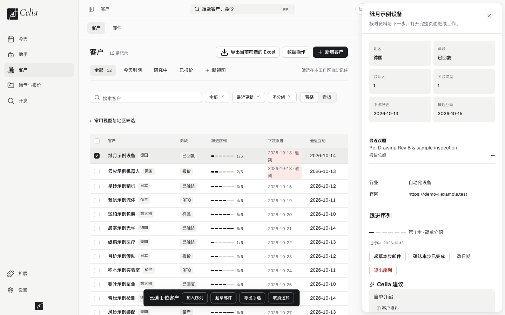
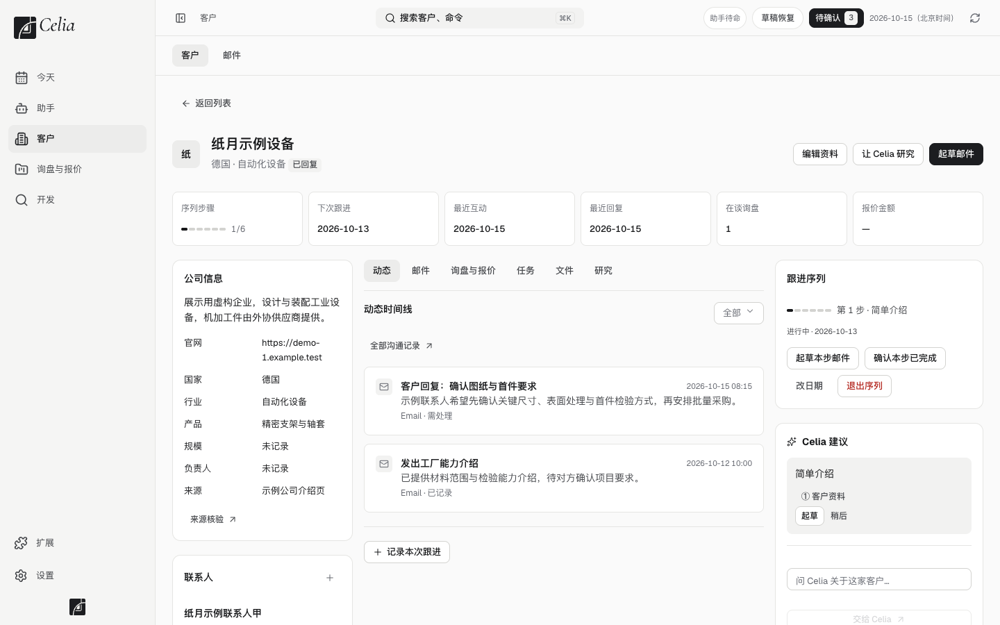

# 4. 客户与联系人

> 适用版本：0.0.9 · 更新：2026-11-01 · [返回目录](../GUIDE.md)

**目的**：把客户和联系人都管在一个地方，每家客户的来往一目了然。
**什么时候用**：新增客户、导入名单、找某家客户、查看客户历史。

---

## 一、客户列表

点左边的 **客户**。

- **顶部数字**：一共有多少家客户。列表每页显示 50 家，翻页在最下面。
- **视图标签**：「全部」「今天到期」「研究中」「已报价」。点「+ 新视图」可以把当前的筛选条件存成一个标签，下次一点就到。
- **搜索框**：按公司名、联系人、网址搜索。
- **表格 / 看板**：表格适合批量看，看板按阶段分列显示。
- **导出当前筛选的 Excel**：把当前看到的客户导出成表格。

---

## 二、新增一个客户

**只记个名字**：客户页右上角点 **快速新建**，或在任何页面按 `⌘K` 输入公司名。填公司名和官网或邮箱就能建，其他资料之后再补。如果客户库里已经有同名公司，会提示你，并可以直接 **打开已有客户**。

**完整填写**：

1. 客户页右上角点 **新增客户**。
2. 表单分两块：
   - **公司**：公司名称*（必填）、官网、国家、行业、公司规模、业务简介。
   - **跟进**：客户阶段、客户评级、客户时区、贸易术语。
3. 几个字段的填法：
   - **国家**：输入中文、英文或国家代码都能搜到，比如「德国」「Germany」「DE」，保存为中文名。
   - **时区**：选好国家后自动填上，可以改。像美国、加拿大这样有多个时区的国家，会先填主要时区，并提示你按客户所在城市核对。
   - **公司规模**：按领英公司页上的员工人数区间选，比如「51–200 人」。
4. 保存后进入客户详情页，再添加联系人。

> 只知道公司名也可以先建，让助手去研究补全，见[让助手工作](05-assistant.md)。

### 客户阶段

| 阶段 | 什么时候用 |
|---|---|
| 未指定 | 还没定 |
| 待开发 | 刚加进来，还在研究、找联系人 |
| 已联系 | 已经发过开发信或联系过，包括对方回复了 |
| 洽谈中 | 在谈询盘、报价或样品 |
| 合作客户 | 已经下单合作 |
| 暂不跟进 | 暂时放下，或者确定没机会 |

0.0.8 及以前的阶段会自动对应过来，例如「已触达」「已回复」都算「已联系」，不用手动改。

---

## 三、导入客户名单

已经有 Excel 名单的，可以一次导入。

### 先把表格整理好

- **第一行是表头**，比如：客户名称、网址、国家、联系人、职位、电子邮箱、电话、其他联系方式、跟进情况。
- **一家公司有多个联系人时**，两种写法都可以：
  - 每行都写上公司名；
  - 只在第一行写公司名，下面几行留空。Celia 会把留空的行归到上面那家公司。
- 一个格子里有多个邮箱或电话，用换行或分号隔开即可，Celia 会拆开。
- 只处理第一个工作表（Sheet）。

### 导入步骤

1. 客户页右上角点 **数据操作 → 导入客户名单**，选择你的 Excel 或 CSV 文件。文件只在你电脑上读取，不会上传。
2. **核对列对应关系**：Celia 会自动认出常见的表头，比如「客户名称」对应「公司名称」。认不出来的列，从下拉框里选对应字段，或者选「忽略」。
   - **公司名称** 必须对应一列。
   - 每个字段只能对应一列。
3. **看预览和「导入前要核对」**：
   - 哪些行会「沿用上方公司」；
   - 同一家公司的几行里，公司资料写得不一样的地方，会标出行号。最常见的是国家列写成了城市。改好原表重新选文件，或者用「逐行审查导入」一行行确认；
   - 没写公司名、但官网和上方公司不一样的行，可能是另一家公司，请核对；
   - 名单里已经在客户库里的公司，会提示你改用「补齐缺失资料」（见下）。
4. 点 **确认导入**。Celia 会一家一家地导入，可以中途暂停，下次选同一个文件继续。
5. **看导入结果**：新增了几家公司、几位联系人、几条跟进记录，跳过了哪些行、为什么。
   - **重复/冲突**：客户库里已经有同名公司。Celia 不会自动覆盖，你可以逐条核对。
   - **无效行**：比如上面没有任何公司的空行，可以修正后单独导入。

### 逐行审查导入

**数据操作 → 逐行审查导入**：每一行由你确认归到哪家公司（已有公司、新建公司、暂不归属，或跳过这一行），确认完才导入。适合表格比较乱、不想先改原表的时候。

### 补齐缺失资料（公司已经在客户库里）

同一份名单导入过一次，或者名单里的公司已经在客户库里了，用 **补齐缺失资料**：

- 在「导入记录与恢复」里已完成的那一批旁边，或导入时的提示里，点 **补齐缺失资料**，重新选择这份文件。在 Excel 里改过也可以。
- 已有的公司直接对上，只补进**联系人、跟进记录和空着的公司资料**；不会重复建公司，也不会改你已经填过的内容。
- 已经在客户库里的联系人和跟进记录不会重复添加，结果页会写明有几条是重复跳过的。

**同一份名单按同样的选择再提交一次**，会提示「这份名单已经按同样的选择导入过了」，按钮变成「已导入过」，客户库不会变化。真要重新导入，先把那一批撤销。

### 导入错了怎么办

**数据操作 → 导入记录与恢复**，找到这一批，可以整批**撤销**。撤销只处理这批创建的内容，你后来改动过的会保留并列出来。撤销不需要原文件。

---

## 四、客户详情页

在列表里点一家客户。

| 位置 | 内容 |
|---|---|
| 顶部数字卡 | 序列进度、下次跟进、最近互动、最近回复、在谈询盘、报价金额 |
| 左边 | 公司信息、前 3 位联系人。点「查看全部」进「联系人」标签 |
| 中间 | **动态时间线**：邮件、回复、跟进记录、研究按时间排在一起。上面的标签可以只看联系人、邮件、询盘与报价、任务、文件、研究 |
| 右边 | 跟进序列、Celia 建议、向 Celia 提问这位客户 |
| 右上角按钮 | 编辑资料、让 Celia 研究、起草邮件 |

### 联系人

- 点 **联系人** 标签，这家公司的所有联系人以卡片列出：姓名、职位、邮箱、电话、领英。卡片上点 **编辑** 直接改。
- 添加：点 **新增联系人**。表单分「身份」（所属公司、姓名、职位、职责类别）和「联系方式」两块。带 `*` 的必填。
- 联系方式只保存在你电脑上，助手看到的是「联系人 1」这样的编号。

### 记录一次跟进

电话、微信、展会上聊的内容，在动态时间线下方点 **记录本次跟进**，写下结果和下一步。

---

### 合并重复客户

同一家公司建了两条：在要并掉的那一家的详情页点 **合并重复客户**，选要保留的那一家，点 **合并到所选客户**。联系人、沟通记录、询盘和报价都移到保留的那一家，这一家从客户列表移走。合并后还没有新增记录时，可以点 **撤销合并** 恢复原样。

### 删除客户和客户回收站

- 在客户详情页点 **删除客户**，或者让助手删。客户会立刻移进**客户回收站**，联系人和沟通记录一起从日常列表里隐藏；原始记录、邮件和报价历史都保留。
- 刚删完，弹出的窗口里有 **撤销删除**，点一下就回来了。
- 过后想找回：客户列表上方点 **客户回收站**，选中后恢复。

---

## 注意事项

- 每家在跟的客户都应该有**下一步**和**下次跟进日期**。
- 联系人的邮箱和电话要有出处。助手会从官网联系页、公开资料里找真实的联系方式，找到后标明来源。按「名.姓@公司.com」拼出来的邮箱没核实前不要发，容易退信，也伤发件邮箱的信誉。

## 常见问题

**我导入了 70 多家，列表里只看到 50 家？**
列表每页 50 家，翻到下一页就能看到。顶部写着总数。

**导入时联系人没进来？**
请确认在第 2 步把「联系人」「电子邮箱」等列对应到了联系人字段，而不是「忽略」。
