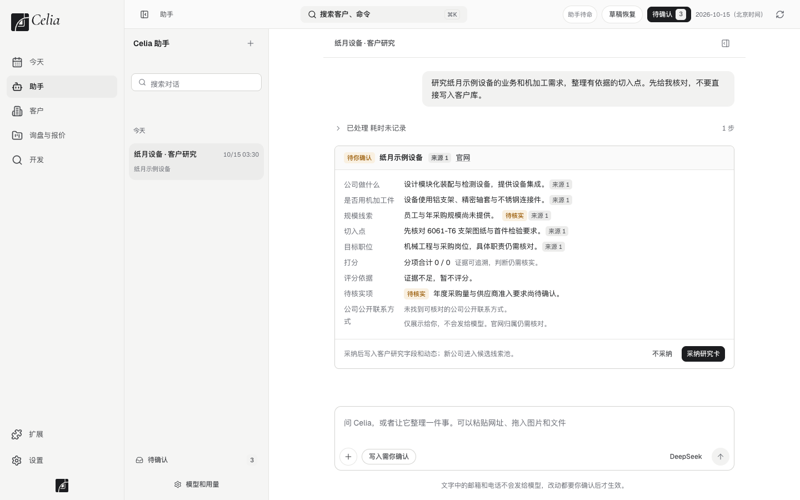

# 5. 让助手工作

> 适用版本：0.0.9.5 · 更新：2026-11-09 · [返回目录](../GUIDE.md)

**目的**：把研究客户、找联系人、写邮件这些费时的事交给助手，你只负责定方向和看结果。
**什么时候用**：开发新客户、准备跟进邮件、整理询盘。

---

## 一、在哪里跟助手说话

- **左边的「助手」**：完整的对话页。点「新对话」开始一件新事情，历史对话都保留在左侧，可以重命名、归档或删除（删除的对话移到废纸篓）。输入框里打 `@` 可以引用客户、询盘或报价，打 `/` 可以调出工作命令（新对话、压缩对话、今日跟进、客户研究、找联系人）。0.0.9.5 起，助手页和浮窗用的都是 Celia 自己的新助手。
- **今天页顶部的输入框**：随手交代一件事。
- **客户详情页右下角**：「问 Celia 关于这家客户……」，助手会自动带上这家客户的资料。

助手改客户资料、写研究笔记会**直接保存**，发邮件和领英私信也会**直接发出**，不再一件件问你。做过的事都记在客户时间线和对话里，可以撤销。想让它先停下，见[首次设置 → 暂停助手](02-setup.md#四暂停助手)。

**大任务会分给子任务**：比如同时研究几个国家的客户，助手会开几个子任务分头查。对话里点「查看子任务」可以看每一个在做什么，子任务的对话只能看，点「返回主对话」回来。

> 你在对话里打的邮箱和电话，不会发给模型。

### 访问模式

输入框下方的「访问模式」决定助手能不能碰任务文件夹以外的东西：**默认**（越出任务文件夹前先问你）、**自动审查**（由模型审查后决定，拿不准就不允许）、**完全访问**（不再询问；受保护的 Celia 数据仍然不能访问）。在 设置 → 助手 → 工作方式 → 「助手可以访问哪里」里改的是同一个设置，两处互相同步。

### 发图片给助手

- 要先在 设置 → 连接 → 模型服务 里，给你用的模型勾上 **支持图片**。没勾的话，助手会告诉你当前模型不能看图、该去哪里改，图片不会发出去。
- 可以把图片拖进对话、粘贴，或点输入框的「+」选择；每条消息最多 4 张（PNG、JPEG、WebP、GIF）。大图会先在你电脑上缩小再发。
- 图片里的邮箱和电话**无法自动替换成编号**，不要发不允许交给模型服务商的内容。
- 之后换成不能看图的模型，对话里以前的图片会换成一句说明，不会发给新模型。

### 复制回复

助手每一轮做完的回复下面有「复制回复」，复制的是这一轮显示出来的文字（不含思考过程、工具步骤和报错）。还在写的回复没有这个按钮。

### 查找历史对话

1. 打开 **设置 → 助手 → 须知与记忆**，在「查找历史对话」一行点 **搜索**。
2. 在右侧面板输入中文关键词，比如「图纸」「公差」「付款」，点 **搜索历史**。已归档的对话，以及从旧版助手搬来的对话，也能搜到。
3. 点 **打开这段对话**，回到助手页接着聊。

从旧版助手搬来的对话带「旧版」标签，只有文字；当时用过的工具步骤和卡片不会搬过来。

### 助手起不来

助手意外退出、反复起不来时，助手页顶部会显示「助手停止了」和原因，右边有 **重新启动助手**。点一下就重新拉起，对话都已保存。点了仍然不行，就退出并重新打开 Celia；还不行，把那条提示截图发给发布者。

---

## 二、研究一家公司

**怎么说：**
> 研究一下 某某公司（官网 example.com），先核对官网与已有资料，看他们会不会用到机加工件。

**助手会给你一张「研究卡」：**

| 栏目 | 含义 |
|---|---|
| 公司做什么 | 主营业务 |
| 是否用机加工件 | 产品里有没有定制金属、塑胶结构件 |
| 规模线索 | 员工数、采购规模，查不到会写明 |
| 切入点 | 可以从哪个具体产品或问题入手 |
| 目标职位 | 该找采购、供应商开发还是机械工程 |
| 打分 / 评分依据 | 证据够才打分，不够会写「证据不足，暂不评分」 |
| 待核实项 | 还没证实的内容，**不要当事实用** |

**每条结论后面都有「来源」标签**，点开可以看出处。

**看完后：**
- 点 **采纳研究卡**：研究结果写进客户资料；如果是新公司，会进入候选线索。
- 点 **不采纳**：什么都不写入。

### 怎么判断值不值得开发

| 等级 | 分数 | 怎么做 |
|---|---|---|
| A | 75–100 | 优先开发，7 天内多个联系人一起触达 |
| B | 60–74 | 正常开发，先确认负责人和项目时间 |
| C | 45–59 | 观察，只做 1–2 次个性化联系 |
| D | 0–44 | 暂缓，等有新消息再说 |

> 军工、武器、受制裁主体：直接排除，或者交人工审查，不进入普通评分。

---

## 三、批量研究

1. 左边点 **开发 → 批量研究**。
2. 每行写一家公司：`公司名称 官网`。
3. 先在助手里核对范围，确认后再开始。已经研究过的公司会复用之前的结果。

---

## 四、找联系人

1. **开发 → 联系人发现**，或者对助手说：
   > 请查找 某某公司 的采购、供应商开发和机械工程负责人，分别列出人员、职责、渠道和公开来源。
2. 助手会从公司官网、公开名单和行业资料里找**真实的**邮箱和电话，每条标明出处；不会按姓名拼一个邮箱充数。找不到的会写明「没找到」。
3. 结果要逐条审，采纳的才会加进联系人。

**找人的优先顺序：**
1. 采购 / 战略采购 / 新产品采购
2. 供应商开发 / 供应链 / 运营
3. 机械 / 硬件工程 / 研发
4. 小公司的创始人 / 总经理

---

## 五、写开发信和跟进邮件

**方法一：从客户详情页**
1. 右上角点 **起草邮件**，或者在跟进序列里点「起草本步邮件」。
2. 助手会参考：这家客户的资料和研究、业务记忆里的「开发信写法」和「工厂能力」（见第八节）、往来记录。
   - 信里写到工厂能力（材料、精度、认证、交期、起订量等）时，助手先查你填的工厂档案，只按档案里填了的内容写，用客户的语言写进正文。档案里空着的项，它不会替你编。
3. 助手写好后直接发出，邮件记在客户时间线和「客户 → 邮件」里。想先看草稿再发，就在要求里说「先写给我看，别发」。

**方法二：直接说**
> 给 某某公司 的采购起草第一封开发信，只讲我们的 5 轴 CNC 铝件能力，100 字以内。

**写好开发信的几条经验：**
- 第一封只讲**一种**和对方产品相关的能力，不要列整个工厂。
- 第二封补一个具体的价值点：一个样件、交期或者质量控制。
- 第三封简短问一下是不是由对方负责，不是的话请他转给对的同事。
- 没回复就先暂缓，等对方有招聘、融资、新产品、展会这类新动静再联系。

---

## 六、把客户加入跟进序列

1. 在客户列表勾选客户，或者在客户详情页操作，选「**加入跟进序列**」。
2. 选择第一步的日期，确认。
3. 之后每一步到期，都会出现在「今天该跟进」里。序列只提醒和帮你起草，**不会自动发送**。到期的这一步用 Celia 发出后，会自动标记完成。

---

## 七、整理询盘

把客户的询盘邮件内容贴给助手：
> 帮我整理这封询盘，列出已知要求和待确认项。

助手会列出材料、数量、公差、表面处理、图纸版本这些已知信息，以及还缺什么。缺的部分可以让它起草一封澄清邮件。

---

## 八、业务记忆：让助手记住你的规矩

助手会记住你的业务习惯，放在 设置 → 我的公司 → **业务记忆**，分三份：

| 记忆 | 记什么 |
|---|---|
| 客户画像 | 什么样的公司值得开发、哪些不要 |
| 开发信写法 | 开发信的语气、长度和不要写的内容 |
| 工厂能力 | 能做和不做的材料、工艺、公差 |

- **在对话里说「记住」**：比如「记住：我们不做钛合金」「记住：开发信别超过 120 个词」，助手会把这条记进对应的那一份，之后写信、评估客户时会读到。记没记上，可以到这里看一眼。
- **也可以自己写**：点那一份旁边的 **查看和修改**（工厂能力还可以点 **按表格填写**），直接写，例如「我们不做钛合金；开发信不超过 120 个英文单词」，点 **保存**。
- **最近一次改动可以撤销**：**改动记录** 里标着是你改的还是助手改的，最新那一条旁边点 **撤销这次改动** 就回到改之前。更早的改动不能单独撤销，直接改回去即可。
- 不要在这里写联系人的邮箱或电话，这里的内容会交给助手读。

---

## 九、报价换币种

客户要别的币种的报价时，对助手说清楚**目标币种和汇率**：

> 把 某某项目 的报价换成欧元，汇率 1 美元 = 0.92 欧元，原因是客户要求欧元报价。

- 助手按你给的汇率生成一版**新的报价草稿**，单价、折扣、费用都按汇率换算，数量不变；
- 原来那一版保留，汇率和原因记在新版本的说明里；
- 不对可以撤销；
- **助手不会自己查或猜汇率。** 你没给汇率，它会先问你。

---

## 注意事项

- **「待核实」不等于事实。** 写进邮件前自己确认。
- 助手说「证据不足」时，不要逼它下结论。
- 助手改了客户资料，客户时间线里会留下记录，不对的话可以撤销。

## 常见问题

**助手没反应或者报错？**
见[遇到问题怎么办 → 助手连不上模型](09-troubleshooting.md#一助手连不上模型)。

**助手写的邮件不像我的风格？**
跟它说「记住：……」，或者到 设置 → 我的公司 → 业务记忆 →「开发信写法」写下你的习惯，见第八节。
