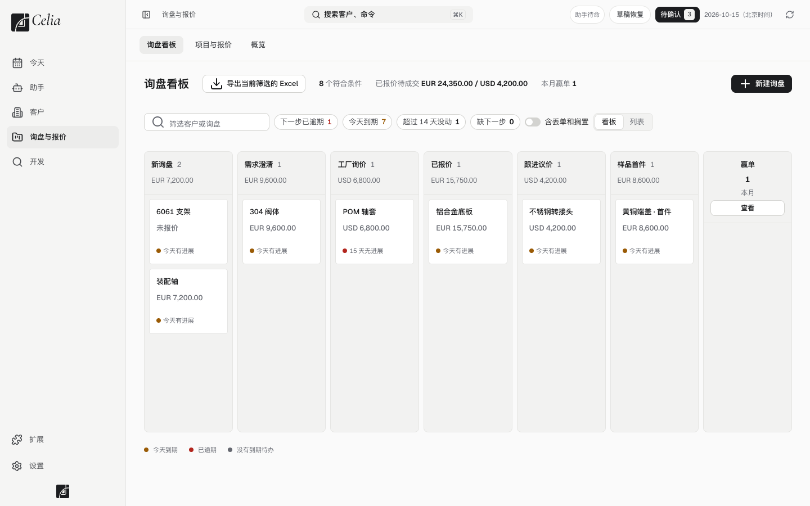

# 6. 询盘与报价

> 适用版本：0.0.9.25 · 更新：2026-11-25 · [返回目录](../GUIDE.md)

**目的**：每个询盘走到哪一步、哪些卡住了，一眼看清；报价金额不混算。
**什么时候用**：收到询盘、准备报价、跟进议价、做样品。

---

## 一、询盘看板

点左边的 **询盘与报价**，上面三个页签：**询盘看板 | 报价单 | 经营数字**。

<p align="center"></p>

每个询盘是一张卡片，从左往右推进：

```
新询盘 → 需求澄清 → 工厂询价 → 已报价 → 跟进议价 → 样品首件 → 赢单
```

- 卡片上的小圆点：🟠 今天到期，🔴 已逾期，⚪ 没有到期待办。
- 顶部筛选：「下一步已逾期」「今天到期」「超过 14 天没动」「缺下一步」。**每天至少看一眼「超过 14 天没动」和「缺下一步」。**
- **卡片上的金额**：询盘自己填了金额，就显示这个金额；没填时，显示所属项目**当前那一版报价**，例如「报价 第 2 版 EUR 12,400.00」，还是草稿的后面注明「（草稿）」。都没有时，「已报价」及之后的列写「金额未填」，之前的列写「未报价」。
- 金额**按币种分别合计**，EUR 和 USD 不会加在一起。
- 跟进日期显示成「10月21日 逾期 11 天」这样，一眼看出还剩几天或晚了几天。
- 「看板 / 列表」可以切换显示方式；「导出当前筛选的 Excel」可以导出。
- **点一张卡片**，进这个询盘自己的一页（见下面「询盘页」）；左上角「← 询盘看板」回来，筛选还在。

---

## 一（续）、询盘页

最上面是询盘名、客户、金额和**阶段条**；点阶段条上后面的步骤，等于「移动阶段」。下面一行是**下一步**和到期日，旁边是 **记录跟进**、**改下一步**、**移动阶段**、**让 Celia 整理这单**。

下面三栏：

- **零件需求**：零件表（零件号、图纸版本、材料、数量和阶梯数量、要求）。还没有时，点 **整理需求** 自己列，或点 **上传图纸让 Celia 读**。「待澄清」的问题列在下面；价格、技术、交期方面没答的问题会挡住报价。
- **报价单**：当前这一版报价显示成一张英文报价单（抬头是「我的工厂」的公司和你的名字）。右上角切换版本，历史版只读。下面写着**报价单检查**：缺哪几项（币种、单价、贸易术语和地点、付款方式、有效期、量产交期、起订量、不含项、样品价、税费），只提醒，不拦你导出。
- **经过**：阶段变化和跟进记录。

### 上传图纸让 Celia 读

1. 在零件需求栏点 **上传图纸让 Celia 读**，选客户的 PDF 图纸（PNG、JPG 要模型支持看图；DWG、STEP 读不了，请客户另出 PDF）。
2. 助手打开，输入框里已经写好「读这张图纸，整理成询盘……的待确认零件需求」，你点发送。
3. Celia 读出图号、版本、材料、数量、表面处理、热处理、关键公差，存成一版**待你确认**的零件需求，每项写明出自第几页、原文是什么。
4. 紧于 ±0.01 mm 的公差和形位公差（位置度、平面度等）会建一条 **请工程师看** 的问题；读不清的写「读不清」，不猜。
5. 回到询盘页，对照图纸检查，点 **确认** 后才变成正式需求，报价才按它算。

> 图纸读错的代价大。确认前一定对着图纸看一遍；扫描件、手写标注读不出来是正常的。

### 做报价、导出、发给客户

- 点 **编辑成新版本**，报价单栏换成表单：每个零件的单价和其他数量的单价、样品价和样品交期（这单要样品时勾上）、贸易术语和交货地点（如 FOB Ningbo）、量产交期（天）、起订量、付款方式（有常用选项）、一次性费用（工装、开模等）、税费、不含项、有效期（只填日期，默认 30 天）。保存成新的一版，旧版保留。
- **导出 Excel**：第一张就是给客户的英文报价单，第二张「内部信息」（状态等）只给自己看。
- **存成 PDF**：打开系统的打印窗口，左下角选 **PDF → 存储为 PDF**。第一次打印时 macOS 可能问「允许 Celia 查找本地网络上的设备」（找打印机用），选「不允许」也能存 PDF。
- **让 Celia 写报价邮件**：带着这版报价打开助手，Celia 写好的信放进今天页「等你过目的信」，你点发送才发出。

---

## 二、新建一个询盘

1. 右上角点 **新建询盘**。
2. 填写带 `*` 的必填项（关联客户、询盘名称等），再尽量补全需求明细。
3. 保存后出现在「新询盘」列。

---

## 三、每个阶段做什么

| 阶段 | 要完成的事 | 进入下一阶段的条件 |
|---|---|---|
| **新询盘** | 读懂需求，关联到客户 | 已经知道缺哪些信息 |
| **需求澄清** | 向客户问清楚缺的信息（见下方清单） | 报价需要的信息都齐了 |
| **工厂询价** | 把图纸和要求发给工厂或车间，拿成本和交期 | 拿到成本和交期 |
| **已报价** | 发出报价 | 客户有反馈 |
| **跟进议价** | 回应价格、交期、条款的讨论 | 双方同意做样品或直接下单 |
| **样品首件** | 做样、首件检验报告 | 样品认可 |
| **赢单** | 拿到订单 | — |

丢单或搁置的询盘可以标记，在看板上打开「含丢单和搁置」就能看到。改到「丢单」时要选一个**主要原因**（价格、交期、能力或认证不符、客户没回复、选了别家、项目推迟或取消、其他），可以再补一句（比如「对方说另一家便宜 8%」）。这些原因会在「经营数字」里汇总。

### 报价前至少要问清楚

- 图纸版本
- 材料
- 数量
- 关键公差
- 表面处理
- 检验标准
- 包装
- 交期
- 目的地
- 应用场景与最终用途

> **最终用途没确认之前，敏感品类不要报价。**

---

## 四、让助手帮忙

- **整理询盘**：「帮我整理这封询盘，列出已知要求和待确认项」。
- **起草澄清邮件**：「针对上面缺的信息，起草一封澄清邮件」。写好后先放进今天页等你过目，你点发送才发出（打开了「助手直接发送」时直接发出）。
- **起草报价跟进**：在客户详情页的「询盘与报价」标签里操作。
- **报价换币种**：告诉助手目标币种和汇率，它生成一版新报价，旧版保留，见[让助手工作 → 报价换币种](05-assistant.md#九报价换币种)。

---

## 五、订单

询盘赢单以后，在 **订单** 页签里跟到收完尾款、客户收到货。

### 从询盘转成订单

- 询盘到了「赢单」，询盘页上面的主按钮变成 **转成订单**。点一下，Celia 用这个询盘最新一版报价建订单：金额、币种、贸易术语和付款方式都照报价抄过来。没有报价的，用询盘上填的金额。
- 已经转过的，按钮变成 **打开订单**。一个询盘只能有一张没取消的订单。
- 没有询盘的单（老客户直接下的 PO），在订单页右上角点 **手工建订单**：先选客户，再填 PO 号、PO 日期、金额。已经做到一半的单，可以直接从后面的阶段开始建，前面的步骤记为「跳过」，要写一句原因。

### 订单看板

```
PO 核对 → 生产 → 样品或首件确认 → 出货 → 收款 → 到货回访 → 已完成
```

- 每张卡片写客户、PO 号、金额和**下一个该到的日期**（定金、出货或尾款）。今天到期是橙色，逾期是红色。
- 上面的筛选：**在做的订单**、**7 天内该出货**、**7 天内该收尾款**、**已完成**、**客诉**。

### 订单页

点一张卡片进订单页。最上面是阶段条和「下一个日期」，旁边：

- **进入「下一步」**：往前走一步。也可以选更后面的阶段，中间跳过的步骤要写原因。
- **改日期和条款**：定金应到和到账、承诺出货和实际出货、尾款应到和到账、客户收货，以及 PO 号、贸易术语、付款方式、定金比例。
- **记一笔经过**：分批出货（写日期和数量）、退回（比如首件不合格要重做）、备注。
- 右边「…」里有 **取消订单**，要写原因。订单不能删。

下面三栏：**PO 与条款**、**日期**（每个应到日期旁边是到账或完成的日期，客诉也在这一栏）、**经过**。

### 按 PO 核对报价

1. 在 PO 与条款栏点 **按 PO 核对报价**，照客户 PO 填 PO 号、日期、币种、交期、贸易术语、交货地点、付款方式，以及每行零件号、数量、单价。
2. 点 **核对**，Celia 列出 PO 和报价不一样的地方（币种、单价、数量、交期、条款）。
3. 有差异时，订单停在「PO 核对」。和客户谈妥、或者接受 PO 的写法以后，点 **确认差异** 并写一句原因，才能进入生产。

> 有没确认的差异时，连「跳过 PO 核对」也不行。这是为了防止按错的价格或条款开工。

### 客诉

- 在订单页「客诉」那里点 **建客诉记录**，写缺陷描述、数量。客户回信被 Celia 认成客诉时，开发页的回信上也有 **建客诉记录**。
- 客诉的状态只能往后：已受理 → 工厂核查中 → 已答复 → 已关闭，可以跨步。关闭以后还能补根因和纠正措施。
- 所有客诉在订单页的 **客诉** 筛选里。

### 今天页「订单到期」

三天内要收定金、出货、收尾款的订单，以及已经过期没记到账或出货的，会排在今天页「订单到期」里。点一下打开订单。

### 复购提醒

一个客户有两张以上已完成的订单时，Celia 按以往下单的平均间隔估一个下次下单的日子，提前 7 天建一条「跟进」待办。

### 让助手帮忙

- 「看一下 Nordic Gear 的订单到哪了」：助手读订单。
- 「NG-0932 今天出货了」：助手记实际出货日期，往后推阶段。助手不能改金额和条款，也不能取消订单。
- 「把客户说的这批件表面划伤记成客诉」：助手建客诉记录。根因和纠正措施由你填。

---

## 六、其他视图

- **报价单**：所有报价一张表（客户、询盘、第几版、状态、金额、有效至、缺几项），点一行进对应的询盘页。没有关联询盘的旧报价，点了打开旧的项目视图。
- **经营数字**：上面是每周一自动生成的**周报**（上一周联系了谁、谁回复了、来了哪些询盘，这一周该跟进的客户）；下面是近 90 天的**首次回复用时**、**报价用时**、**赢单率**、**丢单原因分布**和**本月新询盘**。记录少于 3 条的写「记录不够」，不硬算。

---

## 注意事项

- 每个询盘都要有**下一步**，否则会出现在「缺下一步」里。
- 报价金额填写时注意币种。

## 常见问题

**为什么总金额不是一个数？**
不同币种分别合计，避免按错误汇率混算。
